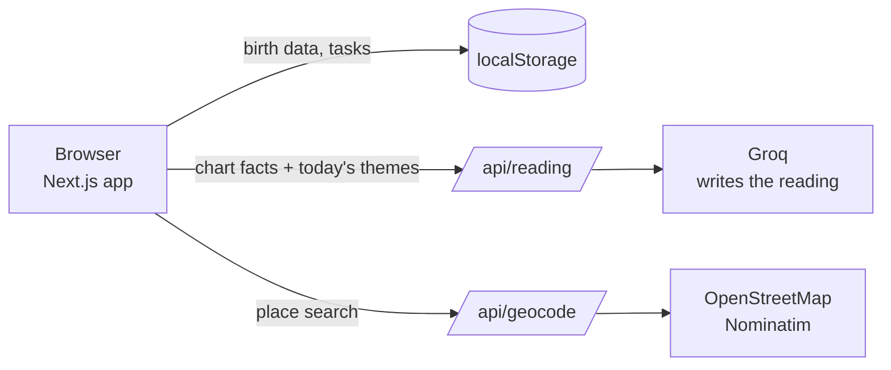

<!-- Replace everything in [brackets] as the project takes shape. -->

# Astro Planner

**Your to-do list, arranged around your star chart.**

Astro Planner reads your natal chart and the day's planetary transits, writes a short daily reading, and ranks your to-do list for the day.

<!-- Add a 10-second GIF of the Today screen here. It's the first thing reviewers look at. -->


---

## What it does

1. **Set up once.** Enter your birth date, birth time (exact, rough, or unknown) and birth place. The app builds your natal chart.
2. **Open it each morning.** Get a short reading based on today's transits to your chart.
3. **See your plan.** Your tasks are ranked for the day, with a one-line reason for the top three.

## Features

- Natal chart with a simple view and a detailed view
- Honest about missing birth details: no houses or rising sign without a birth time, and "estimated" labels where a time is rough
- AI-written daily reading, grounded in calculated transits
- To-do list with categories and due dates
- Task ranking that combines due dates with the day's astrological themes
- No account needed; everything stays in your browser

## Tech stack

| Area | Tools |
| --- | --- |
| App | Next.js, React, TypeScript, Tailwind CSS |
| Chart math | circular-natal-horoscope-js |
| Daily readings | Groq free tier, called from a server route |
| Birth place lookup | OpenStreetMap Nominatim |
| Dates and time zones | Luxon |
| Storage | Browser localStorage |
| Tests | Vitest |

The whole project runs at no cost: free tiers and open-source libraries only.

## How it works



- **The code calculates, the AI writes.** Planet positions, aspects and themes come from the chart library and our own rules. Groq only turns those facts into prose.
- **Privacy:** only chart facts go to Groq: no names, no birth place.
- **Free-tier friendly:** one reading per day, cached in the browser, with a template fallback if Groq's limit is hit.

## Key decisions

Short write-ups of the tradeoffs behind the project live in [`docs/decisions`](docs/decisions):

- [Why a web app instead of a native iPhone app](docs/decisions/001-web-app.md)
- [Why AI-written readings, and why Groq](docs/decisions/002-ai-readings.md)
- [Choosing a chart engine](docs/decisions/003-chart-engine.md)

## Roadmap

v1 is built in eight milestones (see [`docs/spec.md`](docs/spec.md), section 13).

| Milestone | Status |
| --- | --- |
| M1. Skeleton | [Not started] |
| M2. Onboarding | [Not started] |
| M3. Chart | [Not started] |
| M4. Tasks | [Not started] |
| M5. Transits, themes, reading | [Not started] |
| M6. Ranked plan | [Not started] |
| M7. Install and polish | [Not started] |
| M8. Wrap-up | [Not started] |

Next up after v1: hosting, morning energy check-in, hour-by-hour view, chart wheel, optional sign-in, calendar and push notifications.

## Run it locally

**Prerequisites:** Node.js (current LTS) and a free Groq API key.

```bash
cd astro-planner
npm install
cp .env.example .env.local   # then fill in your own values
npm run dev
```

Open http://localhost:3000.

### Environment variables

| Variable | What it's for |
| --- | --- |
| `GROQ_API_KEY` | Server-only key for daily readings |
| `GROQ_MODEL` | Optional; defaults to `openai/gpt-oss-120b` |
| `CONTACT_EMAIL` | Contact address for OpenStreetMap's usage policy |

Never commit real values. `.env*` files are ignored by Git.

### Useful commands

```bash
npm run check   # lint + type check + tests
npm test        # tests only
```

## Project structure

```
src/
  app/          pages and server routes (api/reading, api/geocode)
  components/   UI components
  lib/          chart math, themes, task ranking, storage
  test/         tests and fixture charts
docs/
  spec.md
  decisions/
  screenshots/
```

## Credits

Place search © OpenStreetMap contributors. Chart calculations by circular-natal-horoscope-js. Readings generated with Groq.

## About

Built by Mira, a web developer with over a decade of experience in web development and technical documentation. [One line on what you're looking for, e.g. open to front-end roles.]
