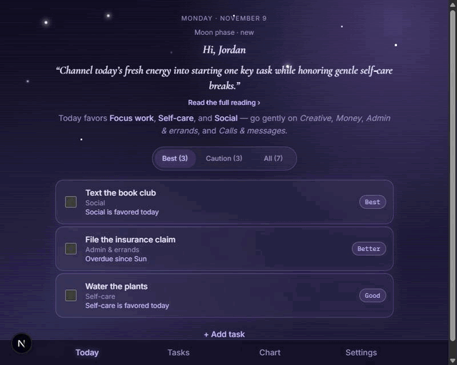
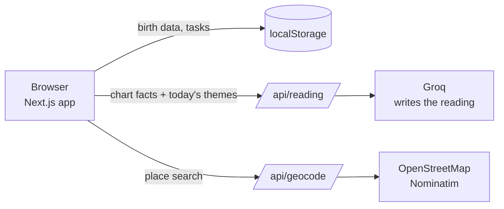

# Stellar

**Your to-do list, arranged around your star chart.**

Stellar reads your natal chart and the day's planetary transits, writes a short daily reading in plain language, and ranks your to-do list for the day. Let's make today stellar!



See [`docs/walkthrough.md`](docs/walkthrough.md) for a screenshot tour of every screen.

---

## What it does

1. **Set up once.** Enter your birth date, birth time (exact, rough, or unknown) and birth place. The app builds your natal chart.
2. **Open it each morning.** Get a short reading based on today's transits to your chart, with a plain-language "why" behind each theme — no astrology jargon required.
3. **See your plan.** Your tasks are ranked for the day across Best / Caution / All tabs, each with a one-word reason (Best, Better, Good, Gentle) backed by the real scoring breakdown on hover.

## Features

- Natal chart with a simple view and a detailed view
- Honest about missing birth details: no houses or rising sign without a birth time, and "estimated" labels where a time is rough
- AI-written daily reading, grounded in calculated transits, with the full astrology translated into plain language (no jargon assumed)
- To-do list with categories and due dates, sortable by due date or today's points
- Task ranking that combines due dates with the day's astrological themes
- Night/Day appearance toggle (defaults to following your system setting)
- Responsive down to phone widths
- No account needed; everything stays in your browser

## Tech stack

| Area | Tools |
| --- | --- |
| App | Next.js, React, TypeScript, Tailwind CSS |
| Chart math | circular-natal-horoscope-js |
| Daily readings | Groq free tier, called from a server route |
| Birth place lookup | OpenStreetMap Nominatim |
| Dates and time zones | Luxon |
| Storage | Browser localStorage |
| Tests | Vitest |

The whole project runs at no cost: free tiers and open-source libraries only.

## How it works



- **The code calculates, the AI writes.** Planet positions, aspects and themes come from the chart library and our own rules. Groq only turns those facts into prose.
- **Privacy:** only chart facts go to Groq: no names, no birth place.
- **Free-tier friendly:** one reading per day, cached in the browser, with a template fallback if Groq's limit is hit.

## Roadmap

v1 is built in eight milestones (see [`docs/spec.md`](docs/spec.md), section 13).

| Milestone | Status |
| --- | --- |
| M1. Skeleton | Done |
| M2. Onboarding | Done |
| M3. Chart | Done |
| M4. Tasks | Done |
| M5. Transits, themes, reading | Done |
| M6. Ranked plan | Done |
| M7. Install and polish | Done |
| M8. Wrap-up | Done |

Next up after v1: hosting, morning energy check-in, hour-by-hour view, chart wheel, optional sign-in, calendar and push notifications.

## Run it locally

**Prerequisites:** Node.js (current LTS) and a free Groq API key.

```bash
git clone https://github.com/mirandawritescode/stellar.git
cd stellar
npm install
cp .env.example .env.local   # then fill in your own values
npm run dev
```

Open http://localhost:3000.

### Environment variables

| Variable | What it's for |
| --- | --- |
| `GROQ_API_KEY` | Server-only key for daily readings |
| `GROQ_MODEL` | Optional; defaults to `openai/gpt-oss-120b` |
| `CONTACT_EMAIL` | Contact address for OpenStreetMap's usage policy |

Never commit real values. `.env*` files are ignored by Git.

### Useful commands

```bash
npm run check   # lint + type check + tests
npm test        # tests only
```

## Deploying

The app is built to run free on [Vercel's](https://vercel.com) free plan — it's a standard Next.js app with no database, so there's nothing else to provision.

1. Push this repo to GitHub (it's local-only right now — `git remote add origin <your-repo-url>` then `git push -u origin main`).
2. In Vercel, "Add New Project" and import that repo. The default Next.js build settings work as-is.
3. In the project's Settings → Environment Variables, add the same three variables from `.env.local` (`GROQ_API_KEY`, `GROQ_MODEL`, `CONTACT_EMAIL`). They're server-only and never reach the browser.
4. Deploy. Everything else (birth data, tasks, cached readings) lives in each visitor's own browser via localStorage — there's no shared state or accounts to set up.

**Worth knowing before sharing a public link:** the "one reading per user per day" cache is per-browser, not per-deployment. Groq's free tier is a single rate limit shared by everyone who uses your deployed URL, so a public link with real traffic could hit that limit faster than it would locally — not a security issue, just a free-tier ceiling worth watching if usage grows.

## Project structure

```
src/
  app/          pages and server routes (api/reading, api/geocode)
  components/   UI components
  lib/
    astro/      natal chart, transits, aspects, themes, plain-language explanations
    planner/    task scoring
    storage/    typed localStorage helpers
    types.ts    shared types
  test/         tests and fixture charts
docs/
  spec.md                   full build spec
  walkthrough.md            screenshot tour (see note above)
  walkthrough-screenshots/
```

## Credits

Place search © OpenStreetMap contributors. Chart calculations by circular-natal-horoscope-js. Readings generated with Groq.

## About

Built by Mira, a web developer with over a decade of experience in web development and technical documentation.

<!-- TODO before sharing: add one line on what you're looking for, e.g. "open to front-end roles." -->
