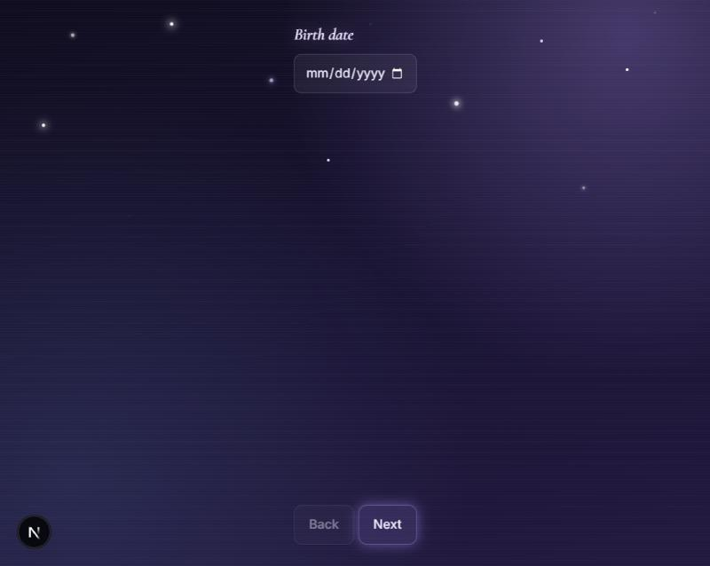
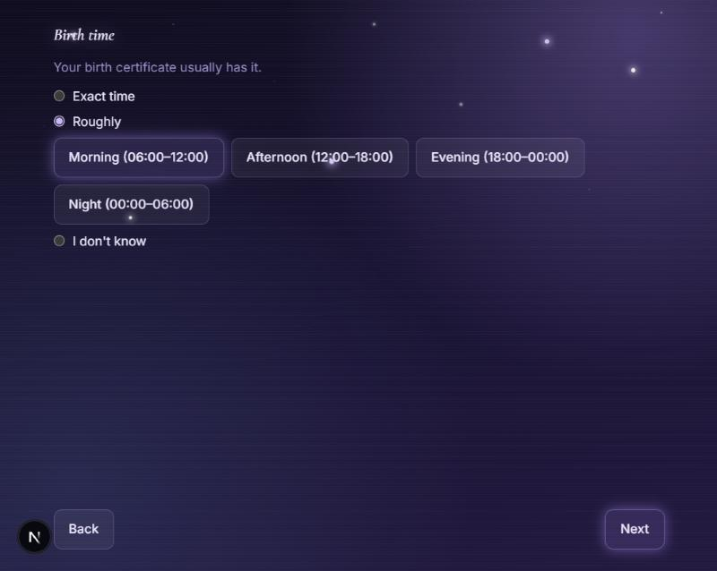
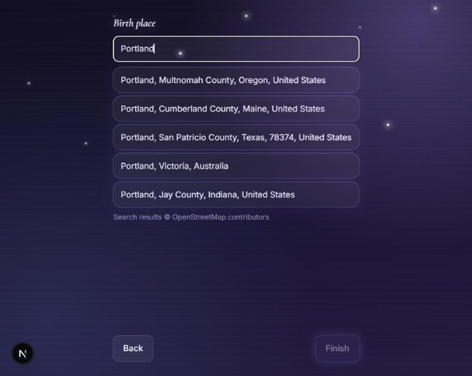
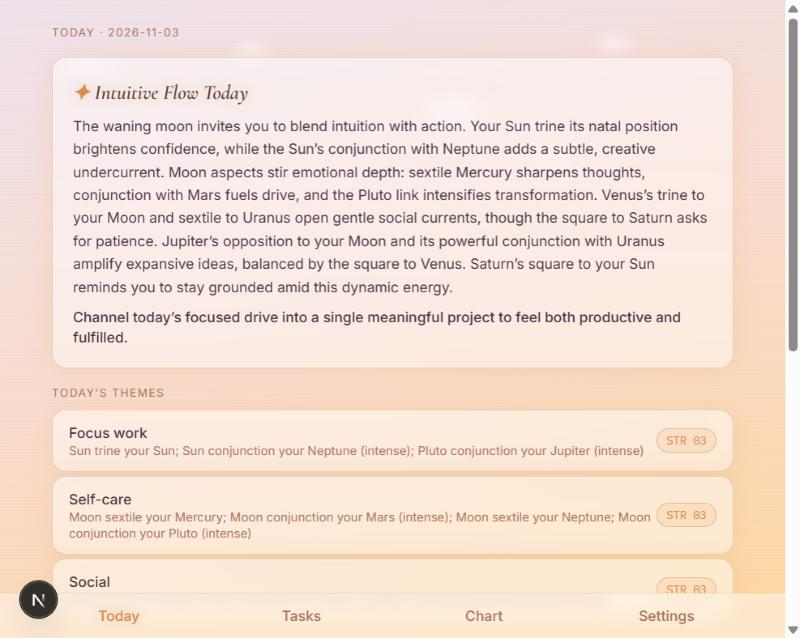

# Astro Planner — Walkthrough

A screenshot tour of every screen in the app, as of 2026-11-03 (through M7). Screenshots are from the Night theme unless noted; see the bottom of this doc for the Day theme.

---

## Onboarding

New users answer three questions, one per step, with Back/Next.

### Step 1 — Birth date

### Step 2 — Birth time

Exact time, a rough window, or "I don't know" — the app adapts later screens to whichever is chosen (an unknown time means no houses or rising sign anywhere in the UI).

### Step 3 — Birth place

A debounced search against OpenStreetMap Nominatim, with required attribution.

---

## Today (`/`)

The home screen: an AI-written daily reading (generated server-side via Groq, from chart facts only — never personal details), a breakdown of the day's astrological themes, and the to-do list ranked against those themes. Each of the top 3 tasks shows the single strongest reason it's ranked where it is; every task shows its numeric score.

---

## Tasks (`/tasks`)

The full task list — open tasks first, then recently completed ones (crossed out). Add, edit, and delete (with a confirm step) all happen inline.

### Add task form

---

## Chart (`/chart`)

### Simple view

Sun, Moon, and rising sign (when known) in plain language, plus the rest of the planets.

### Detailed view

Adds exact degrees, houses, and a full natal aspects table.

---

## Settings (`/settings`)

Currently just the data-reset option. Edit-birth-details and About/credits are still open items for M8.

---

## Night vs. Day theme

The app follows `prefers-color-scheme` with no manual toggle — deep indigo and stars at night, a sunrise gradient and drifting clouds by day.

**Night** (see Today screenshot above) · **Day:**

---

## Notes

- All screenshots are desktop width; the layout is also responsive down to phone widths (verified at 375px and 320px) as of the 2026-11-03 responsive pass.
- Not pictured: loading/empty/error states (e.g. "No tasks yet," a failed Groq call falling back to a quick-guide reading, a failed localStorage save) — these all exist per-screen but are harder to capture as a static screenshot.
