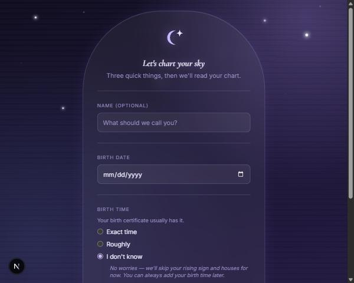
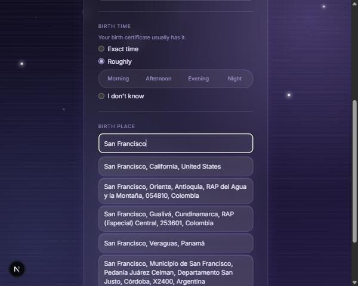
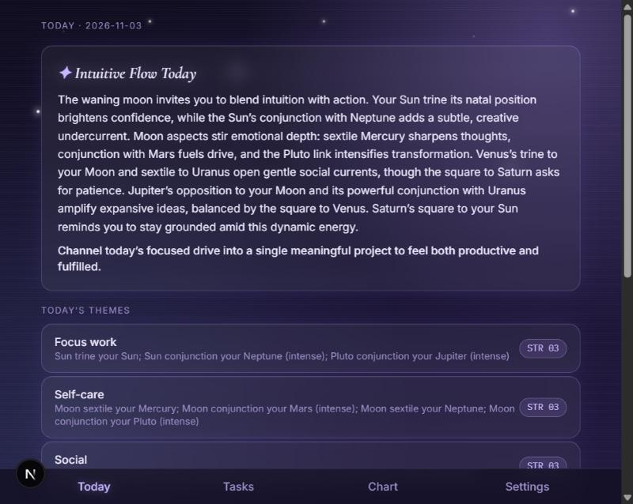
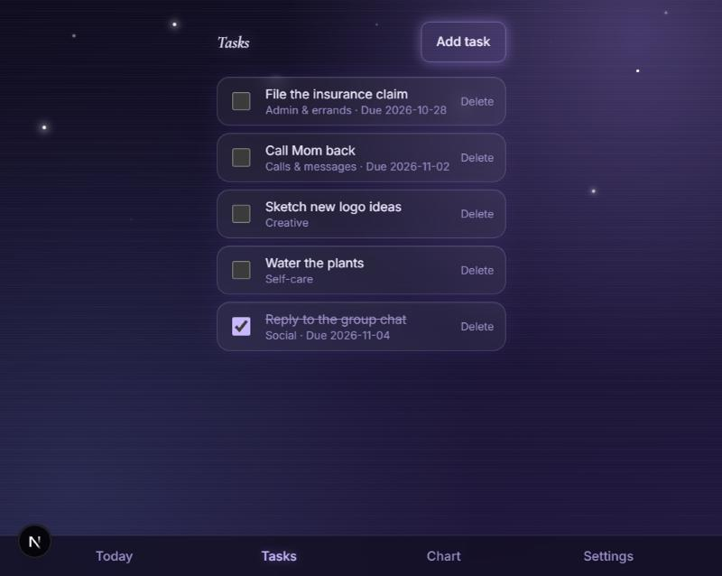
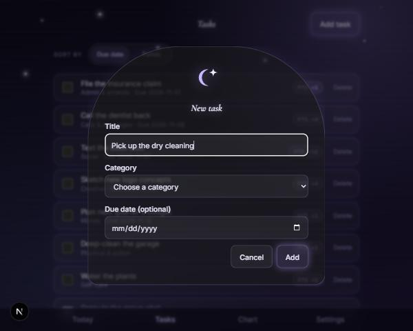
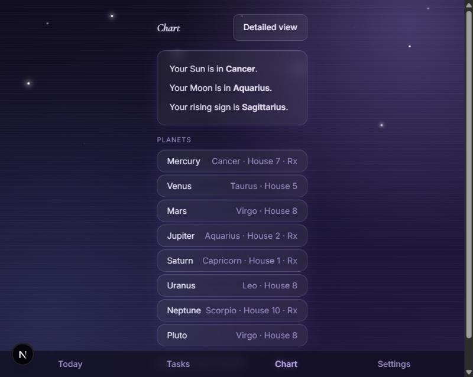
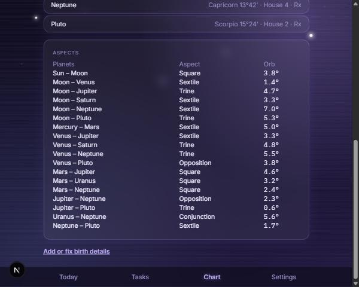
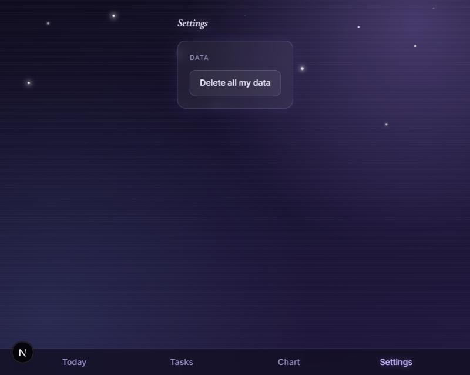
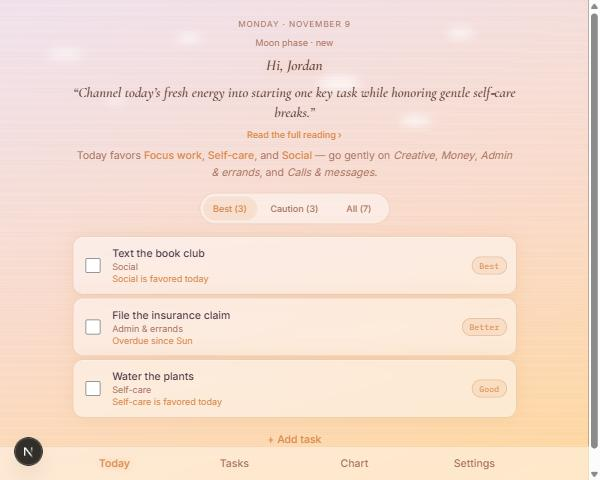

# Stellar — Walkthrough

A screenshot tour of every screen in the app, as of 2026-11-09 (through M7, plus the Today page redesign and Night/Day toggle built after). Screenshots are from the Night theme unless noted; see the bottom of this doc for the Day theme.

---

## Onboarding (`/onboarding`)

A single scrolling form: name (optional), birth date, birth time (exact, rough, or unknown — an unknown time means no houses or rising sign anywhere in the UI later), and a debounced birth place search against OpenStreetMap Nominatim, with required attribution.

Choosing "Roughly" reveals a time-of-day picker instead of an exact time; the place search shows live results as you type.

---

## Today (`/`)

The home screen. A short pull-quote from the AI-written daily reading (generated server-side via Groq, from chart facts only — never personal details) expands in place to the full reading plus a plain-language "why" behind each of today's themes — no astrology jargon assumed. Below that, a one-line mood summary and Best / Caution / All tabs over the ranked to-do list. Each task shows a plain-language tier chip (Best, Better, Good, Gentle) with the full scoring breakdown on hover.

---

## Tasks (`/tasks`)

The full task list — open tasks first, then completed (last 7 days). A "Sort by" toggle switches the open-task order between due date and today's points, with the same hover breakdown as Today. Add, edit, and delete (with a confirm step) all happen inline.

### Add task form

---

## Chart (`/chart`)

### Simple view

Sun, Moon, and rising sign (when known) in plain language, plus the rest of the planets.

### Detailed view

Adds exact degrees, houses, and a full natal aspects table.

---

## Settings (`/settings`)

Data reset (with a confirm step), the Appearance toggle, and an About/credits card (not pictured above — added after this screenshot was taken).

---

## Night vs. Day theme

Settings → Appearance has an Auto / Day / Night toggle (Auto follows `prefers-color-scheme`). Deep indigo and stars at night, a sunrise gradient and drifting clouds by day.

**Night** (see Today screenshot above) · **Day:**

---

## Notes

- All screenshots are desktop width; the layout is also responsive down to phone widths (verified at 375px and 320px).
- Not pictured: loading/empty/error states (e.g. "No tasks yet," a failed Groq call falling back to a quick-guide reading, a failed localStorage save) — these all exist per-screen but are harder to capture as a static screenshot.
